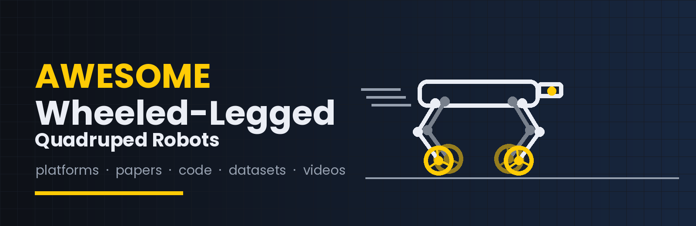

# Awesome_Wheeled_Quadrupedal_Robots 

> A curated list of **wheeled-legged quadruped robots** — robots with four legs *and* wheels — covering platforms, papers, open-source code, simulation assets, datasets, videos, labs and talks. Built for researchers.

> 🛞 **Why a separate list?** Wheeled-legged quadrupeds (a.k.a. *wheel-legged*, *legged-wheeled*, *hybrid-locomotion*, *driving-stepping* robots) combine the efficiency and speed of wheels with the terrain versatility of legs. The field has exploded since ANYmal got wheels in 2018 — Swiss-Mile/RIVR, Unitree Go2-W & B2-W, DEEP Robotics Lynx, LimX W1, Tencent Max — yet the literature is scattered across legged-robot lists. This list collects only the wheeled ones. For purely legged quadrupeds see the excellent [Awesome_Quadrupedal_Robots](https://github.com/curieuxjy/Awesome_Quadrupedal_Robots), which inspired this format.

> 🔤 Except where noted (timeline, "good to start"), items are in alphabetical order within each block. Papers are grouped by the year they first appeared (arXiv date counts).

> 🙏 Found a mistake or a missing entry? Open an [issue](../../issues) or a [pull request](CONTRIBUTING.md). Contributions are very welcome — this is a small community and every entry counts.

## Contents

- [Good to start 🧐](#good-to-start-)
- [Timeline 📅](#timeline-)
- [Wheeled-Legged Quadrupeds 🛞🐕](#wheeled-legged-quadrupeds-)
- [Papers 📑](#papers-)
- [GitHub 💻](#github-)
- [YouTube 🎥](#youtube-)
- [Labs & Companies 👥](#labs--companies-)
- [Talks, Workshops & Tutorials 🎤](#talks-workshops--tutorials-)
- [Related Materials 🔗](#related-materials-)
- [Contributing](#contributing)
- [License](#license)

---
## Good to start 🧐

*Read / watch these first — in suggested order, not alphabetical.*

1. 📰 [Wheels Are Better Than Feet for Legged Robots](https://spectrum.ieee.org/wheels-are-better-than-feet-for-legged-robots) — IEEE Spectrum interview with Marko Bjelonic on why ANYmal got wheels. The best 10-minute intro to the field.
2. 📄 [A Survey of Wheeled-Legged Robots](https://link.springer.com/chapter/10.1007/978-3-031-15226-9_11) — Bjelonic, Klemm, Lee & Hutter's short survey (CLAWAR 2022): taxonomy, history, open problems.
3. 📄 [Keep Rollin' – Whole-Body Motion Control and Planning for Wheeled Quadrupedal Robots](https://arxiv.org/abs/1809.03557) — the paper that kicked off modern wheeled-legged quadruped control (RA-L 2019). [Video](https://youtu.be/nGLUsyx9Vvc)
4. 📄 [Rolling in the Deep – Hybrid Locomotion for Wheeled-Legged Robots using Online Trajectory Optimization](https://arxiv.org/abs/1909.07193) — hybrid walking–driving with online TO (RA-L 2020). [Video](https://www.youtube.com/watch?v=ukY0vyM-yfY)
5. 📄 [Learning Robust Autonomous Navigation and Locomotion for Wheeled-Legged Robots](https://www.science.org/doi/10.1126/scirobotics.adi9641) — the Science Robotics 2024 paper behind Swiss-Mile/RIVR: end-to-end RL for a wheeled quadruped across a city. [arXiv](https://arxiv.org/abs/2405.01792) · [Video](https://www.youtube.com/watch?v=vJXQG2_85V0)
6. 🎓 [Planning and Control for Hybrid Locomotion of Wheeled-Legged Robots](https://doi.org/10.3929/ethz-b-000515694) — Marko Bjelonic's PhD thesis (ETH Zürich, 2021): the most complete treatment of model-based wheeled-legged locomotion. [Talk](https://www.youtube.com/watch?v=Afwv-H4z-f0)
7. 💻 [fan-ziqi/robot_lab](https://github.com/fan-ziqi/robot_lab) — the quickest way to train a wheeled-quadruped policy today: Isaac Lab tasks for Go2-W, B2-W and Lynx M20 out of the box; deploy with [rl_sar](https://github.com/fan-ziqi/rl_sar).
8. 🎤 [1st Workshop on Wheeled-Legged Robots (IROS 2025)](https://www.wheeledleggedrobotics.com/) — the field's first dedicated workshop; schedule, speakers and a simulation competition.
9. 🛒 Want hardware? The entry-level research platform today is the [Unitree Go2-W](https://www.unitree.com/go2-w); industrial options are the [Unitree B2-W](https://www.unitree.com/b2-w), [DEEP Robotics Lynx M20](https://www.deeprobotics.cn/en/wap/lynx.html) and [LimX W1](https://limxdynamics.com/en/wheeled-quadruped-robot).

---

## Timeline 📅

*Milestones of wheeled-legged quadrupeds (chronological).*

| Year | Milestone |
|---|---|
| 1994 | Tokyo Tech's **Roller-Walker** puts passive wheels on the soles of a quadruped (TITAN-VIII) — the first "roller-skating" legged robot. |
| 2006 | McGill's **PAW** bounds and rolls on wheels at the ends of springy legs. |
| 2012–14 | NTU's **Quattroped** and **TurboQuad** morph a full wheel into a two-semicircle leg. |
| 2015 | Univ. of Bonn's **Momaro** (4 legs, 2 steerable wheels each) and JPL's **RoboSimian** compete in the DARPA Robotics Challenge Finals (4th and 5th). The EU **CENTAURO** project (IIT + Bonn, 2015–2018) builds a wheeled-legged quadruped with a humanoid torso. |
| 2016 | DFKI's **SherpaTT** wheel-on-leg rover begins Mars-analogue field campaigns. |
| 2018 | ETH Zürich RSL puts non-steerable torque-controlled wheels on **ANYmal** — *Skating with a Force Controlled Quadrupedal Robot* (IROS 2018) and *Keep Rollin'* (RA-L 2019). ETH CRL's **Skaterbots** (SIGGRAPH) co-design legged-wheeled creatures. |
| 2019–20 | *Rolling in the Deep*: online TO for hybrid walking–driving; trajectory optimisation with linearised ZMP constraints; terrain-aware TO on stairs and steps (RA-L 2019–20). |
| 2021 | Tencent Robotics X unveils **Max** (wheels on the knees, 25 km/h); Hyundai shows **TIGER X-1**; Bjelonic's PhD thesis; whole-body MPC + online gait sequence generation (IROS 2021). **Swiss-Mile** spins out of ETH RSL to commercialise the wheeled ANYmal. |
| 2022 | Kawasaki shows the rideable **Bex**; Tencent's **Max 2** balances on two wheels; Bonn puts driven wheels on a Mini Cheetah. First surveys of wheeled-legged robots (CLAWAR 2022). |
| 2023 | **LimX Dynamics W1** (Sept) — China's first commercial wheeled quadruped; it later stands up as a 152 cm biped (2024). |
| 2024 | **Unitree Go2-W** (Aug) and **B2-W** make wheeled quadrupeds affordable for labs. **DEEP Robotics Lynx** launches (Nov). *Learning Robust Autonomous Navigation and Locomotion for Wheeled-Legged Robots* appears in **Science Robotics**. Swiss-Mile raises $22M from Bezos Expeditions / HongShan. |
| 2025 | Swiss-Mile completes its rebrand to **RIVR**; delivery pilots with Evri (UK) and Veho (Austin). **Lynx M20** (Apr), **Unitree A2-W** (Aug), **MagicDog-W** (Jul), **DOBOT Rover X1** at ~$1k (Nov). **1st Workshop on Wheeled-Legged Robots** at IROS 2025 with an ANYmal-on-Wheels simulation competition. Wave of Go2-W / B2-W RL papers. |
| 2026 | **Amazon acquires RIVR** (March). DEEP Robotics ships **Lynx M20S** (Apr) and **Lynx S10** (May); Unitree reveals **As2-W** (Jul); Robot.com announces **R-dog** (Aug); IIT's **KYON** adds bimanual arms to a wheel-legged quadruped. MDPI *Robotics* runs a special issue on wheeled-legged robot systems. |

---
## Wheeled-Legged Quadrupeds 🛞🐕

> **Wheel placement legend:** *feet* = driven wheel replaces the foot · *knees* = wheels on the knee, robot kneels to roll · *passive* = unpowered wheels/skates · *transformable* = wheel ↔ leg morphing.

<b>Commercial platforms</b>

| Robot | Company (Country) | Year | Wheels | Key specs / notes | Links |
|---|---|---|---|---|---|
| **A2-W** | Unitree (CN) | 2025 | feet | ~52 kg, 3 m/s (6 max), 25 kg continuous / 100 kg standing load, dual hot-swap batteries | [Official](https://www.unitree.com/A2-W) · [Launch](https://www.therobotreport.com/unitree-launches-a2-quadruped-equipped-with-front-and-rear-lidar/) |
| **As2-W** | Unitree (CN) | 2026 | feet | 25 kg, 3.7 m/s (6 max), 16 kg walking / 150 kg static load, 80 cm obstacles, 45° slopes, IP54 | [Official](https://www.unitree.com/As2-W) · [Review](https://www.i-programmer.info/news/169-robotics/19030-unitree-as2-w-impressive-all-terrain-robot.html) |
| **B2-W** | Unitree (CN) | 2024 | feet | ~85 kg, 15 km/h, 40 kg walking / 120 kg standing load, ~30 km range, IP67, −20…55 °C; Swiss-Mile's 2024 fleet and ETH's SRU navigation project were built on it | [Official](https://www.unitree.com/b2-w) · [URDF](https://github.com/unitreerobotics/unitree_ros) |
| **Go2-W** | Unitree (CN) | 2024 | feet | ~18 kg, 2.5 m/s, 8 kg payload, 1.5–3 h, 70 cm climb; the most-used research wheeled quadruped in 2025–26 papers | [Official](https://www.unitree.com/go2-w) · [Launch](https://www.therobotreport.com/unitree-go2-quadruped-hits-the-road-with-new-wheels/) · [URDF](https://github.com/unitreerobotics/unitree_ros) |
| **Genisom L1W** | ZSBot / zsibot (CN) | 2025 | feet | Wheel-legged quadruped; community ROS 2 driver | [ROS 2 driver](https://github.com/DarmawanRobotics/l1w_ros2) |
| **Lynx** | DEEP Robotics (CN) | 2024 | feet | 30 kg, 5 m/s, 12 kg payload, 3 h / 15 km, 22 cm steps, 45° slopes, IP54, $17,999 | [Official](https://deeprobotics.cn/en/wap/deeproboticslynx.html) · [Launch](https://www.robotics247.com/article/deep_robotics_launches_lynx_all_terrain_off_road_robot/industries) |
| **Lynx M20 / M20 Pro** | DEEP Robotics (CN) | 2025 | feet | 33 kg, 15 kg rated / 50 kg max payload, 80 cm single step, IP66, −20…55 °C, hot-swap batteries, symmetric joints (drives both ways) | [Official](https://www.deeprobotics.cn/en/wap/lynx.html) · [Launch](https://www.robotics247.com/article/deep_robotics_launches_lynx_m20_wheel_legged_robot_for_unstructured_environments) · [Models](https://github.com/DeepRoboticsLab/deep_robotics_model) · [RL](https://github.com/DeepRoboticsLab/rl_training) |
| **Lynx M20S** | DEEP Robotics (CN) | 2026 | feet | Next-gen M20; model files in `deep_robotics_model` | [Press](https://www.accessnewswire.com/newsroom/en/industrial-and-manufacturing/deep-robotics-lynx-m20s-launched-breaking-the-performance-paradox-of-w-1167678) |
| **Lynx S10 / S10 Pro** | DEEP Robotics (CN) | 2026 | feet | ≤20 kg, 8 m/s, 16 joints, 50 cm obstacles, 120 kg max load, IP66 | [Official](https://deeprobotics.cn/en/index/lynxs10.html) · [Launch](https://www.163.com/dy/article/KTFRC8P90514R9P4.html) |
| **MagicDog-W** | MagicLab 魔法原子 (CN) | 2025 | feet | 22.5 kg, 3 m/s, 10 kg payload, 2–4 h, 7-inch pneumatic tires, 16+1 motors | [Official](https://www.magiclab.top/en/dog-w) · [Specs](https://www.magiclab.top/en/dog-w/DogTable) · [SDK](https://github.com/MagicLabRobotics/MagicDog_SDK) |
| **R-dog** | Robot.com (US) | 2026 | feet | Delivery + advertising quadruped, FieldAI navigation stack; availability 2027 | [Official](https://www.robot.com/r-dog) · [News](https://newatlas.com/robotics/r-dog-quadruped-delivery-robot/) |
| **RIVR One / RIVR Two** (ex-Swiss-Mile) | RIVR / Amazon (CH) | 2021– | feet | Last-mile delivery; stands upright on two wheels; Rivr Two: >60 lb compartment, 8.7 mph, climbs stairs; acquired by Amazon March 2026 | [Official](https://www.rivr.ai/) · [Acquisition](https://techcrunch.com/?p=3104295) |
| **Rover X1 (Pro Flex)** | DOBOT / INFFNI (CN) | 2025 | feet (swappable) | 21.5 kg, 3 m/s wheeled, 3–7 kg payload, ~$1,030 in China — cheapest wheel-foot quadruped | [Official](https://inffnitech.com/products/rover-x1) · [Launch](https://www.technode.com/2025/11/04/dobot-rover-x1-robot-dog-debuts-at-1030-carries-items-and-follows-for-filming/) · [SDK](https://github.com/Dobot-Team/dobot_quad_sdk) |
| **W1** | LimX Dynamics (CN) | 2023 | feet | 40 kg, 16 DoF, 5.98 m/s, 15 kg payload, 4 h; stands up into a 152 cm biped in ≤1 s (2024) | [Official](https://limxdynamics.com/en/wheeled-quadruped-robot) · [Launch](https://www.limxdynamics.com/en/news/BK000028) · [Biped mode](https://www.limxdynamics.com/en/news/BK000034) |

<b>Research platforms & concepts</b>

| Robot | Organisation (Country) | Year | Wheels | Notes | Links |
|---|---|---|---|---|---|
| **ALPHRED** | UCLA RoMeLa (US) | 2020 | passive casters | Radially symmetric quadruped for package delivery | [Paper](https://doi.org/10.1109/LRA.2020.3007482) |
| **ANYmal on Wheels (AoW)** | ETH Zürich RSL (CH) | 2018 | feet | Non-steerable torque-controlled wheels on ANYmal; 4 m/s, −83 % cost of transport vs legged; lineage → Swiss-Mile → RIVR | [Keep Rollin'](https://arxiv.org/abs/1809.03557) · [Model](https://github.com/leggedrobotics/wlr-competition-2025) |
| **Bex** | Kawasaki Heavy Industries (JP) | 2022 | knees | Ibex-styled rideable robot, ~100 kg cargo, modular upper body | [News](https://www.engadget.com/kawasaki-bex-robot-203541844.html) |
| **BJTUBOT** | Beijing Jiaotong Univ. (CN) | 2023 | feet | Side-mounted 5-DoF hybrid parallel legs, multi-mission earth rover | [Paper](https://link.springer.com/article/10.1007/s11465-022-0740-0) |
| **CENTAURO** | IIT HHCM + Univ. Bonn (IT/DE) | 2018 | feet (steerable) | Four legs with steerable wheels + humanoid torso with two arms, 93 kg; EU H2020 disaster-response project | [Project](https://www.centauro-project.uni-bonn.de/) · [Paper](https://doi.org/10.1109/LRA.2019.2896758) · [ROS pkgs](https://github.com/ADVRHumanoids/iit-centauro-ros-pkg) |
| **Elevate / TIGER X-1** | Hyundai Motor Group (KR/US) | 2019 / 2021 | feet (retractable leg-wheel units) | "Walking car" concepts; TIGER is an uncrewed cargo UMV designed with Autodesk generative design | [Official](https://www.hyundai.com/au/en/news/mobility/hyundai-motor-group-unveils-tiger-uncrewed-ultimate-mobility-vehicle-concept) |
| **FLORES** | HKUST(GZ) (CN) | 2025 | feet | Reconfigured wheel-legged quadruped with hip-yaw front legs; open mechanical design | [Paper](https://arxiv.org/abs/2507.22345) · [Code+CAD](https://github.com/ZhichengSong6/FLORES) |
| **KYON** | IIT HHCM (IT) | 2026 | feet (reconfigurable) | Semi-modular wheel-legged quadruped with swappable wheel/leg lower limbs and bimanual upper body | [Paper](https://arxiv.org/abs/2606.30243) |
| **LEVA** | ETH Zürich RSL (CH) | 2025 | feet | High-mobility logistics vehicle with legged suspension, carries a standard Euro cargo box | [Paper](https://doi.org/10.1109/ICRA55743.2025.11128847) |
| **Lywal** | — (CN) | 2021 | transformable | Leg-wheel transformable quadruped with pick-up and transport functions | [Paper](https://ieeexplore.ieee.org/document/9561128/) · [Video](https://www.youtube.com/watch?v=mtlygIGOYEE) |
| **M4 Morphobot** | Caltech CAST + Northeastern (US) | 2023 | transformable (wheel / leg / rotor) | Eight locomotion modes: roll, walk, fly, two-wheel stand, tumble… (Nature Communications 2023) | [News](https://cast.caltech.edu/news/new-bioinspired-robot-flies-rolls-walks-and-more) |
| **Max / Max 2** | Tencent Robotics X (CN) | 2021 / 2022 | knees | 25 km/h; Max 2 balances on two wheels on plum-blossom piles; IEEE T-ASE paper | [Paper](https://ieeexplore.ieee.org/document/10375960/) · [News](https://www.chinamoneynetwork.com/2021/03/05/tencents-new-robotic-dog-max-has-wheels-on-its-knees-can-travel-at-25km-hour) · [Max 2](https://www.eyeshenzhen.com/content/2022-08/10/content_25300827.htm) |
| **Momaro** | Univ. Bonn AIS / NimbRo (DE) | 2015 | feet (pairs of steerable wheels) | Four compliant legs each ending in two directly driven steerable wheels, anthropomorphic torso; DRC Finals 2015 4th overall | [Project](https://ais.uni-bonn.de/nimbro/Rescue) · [Paper](https://arxiv.org/abs/1810.01345) |
| **PAW** | McGill CIM (CA) | 2006 | feet on springy legs | Bounding + rolling hybrid; an early wheeled-leg quadruped | [Paper](https://doi.org/10.1109/ROBOT.2006.1642323) |
| **Pegasus** | — (CN) | 2024 | underactuated wheel-legs | Bio-inspired quadruped with underactuated wheeled-legged mechanism (ICRA 2024) | [Paper](https://ieeexplore.ieee.org/document/10611633/) |
| **Pholus** | A*STAR / NUS (SG) | 2020 | feet | Wheeled-legged quadruped with dual arms; hybrid locomotion planning | [Paper](https://oar.a-star.edu.sg/storage/v/vdqy86kzw2/main.pdf) |
| **Quattroped / TurboQuad** | NTU BioRoLa (TW) | 2012 / 2014 | transformable | Full circular wheel morphs into a two-semicircle leg; TurboQuad switches modes while moving | [Lab](https://biorola.me.ntu.edu.tw/research_legged_quadruped.html) · [TurboQuad](https://doi.org/10.1109/ICRA.2014.6907143) |
| **RoboSimian** | NASA JPL (US) | 2015 | passive → driven (wheel-on-limb rover) | Four 7-DoF limbs; DRC Finals 5th; later fitted with driven wheels for glacier / Death Valley analog tests | [JPL](https://www-robotics.jpl.nasa.gov/how-we-do-it/systems/robosimian/) · [DRC](https://www.jpl.nasa.gov/news/robosimian-drives-walks-and-drills-in-robotics-finals/) |
| **Roller-Walker** | Tokyo Tech, Hirose/Endo (JP) | 1994– | passive (soles) | Passive wheels on the soles of TITAN-VIII; ~2.2 m/s skating — the classic | [Lab](https://www.robotics.mech.e.titech.ac.jp/gendo/en/?p=57) · [Paper](https://doi.org/10.1163/156855312X633066) |
| **SherpaTT** | DFKI RIC Bremen (DE) | 2016 | feet | Four 5-DoF legs with driven wheels, actively articulated suspension, ~150 kg; Mars-analogue field tests (Utah, Morocco) | [DFKI](https://robotik.dfki-bremen.de/en/research/robot-systems/sherpatt) · [Paper](https://www.dfki.de/fileadmin/user_upload/import/10208_cordes2018.pdf) |
| **Skaterbots** | ETH CRL (CH) | 2018 | feet | Optimisation-based co-design of legged-wheeled creatures (SIGGRAPH 2018) | [Paper](https://crl.ethz.ch/papers/Skaterbots.pdf) |
| **SlidBot** | NUIST (CN) | 2025 | passive (knees) | Quadruped with knee-mounted passive wheels for roller skating | [Paper](https://link.springer.com/article/10.1007/s42235-025-00770-0) |
| **Wheeled Mini Cheetah** | Univ. Bonn AIS (DE) | 2022 | feet | Mini Cheetah with actively driven non-steerable wheels; driving-stepping MPC and estimation | [Paper](https://arxiv.org/abs/2211.11390) |
| **Wheel-legged separation quadruped** | Taiyuan Univ. of Tech. (CN) | 2023 | transformable | Mechanism switches between wheel and leg modes | [Paper](https://www.cambridge.org/core/journals/robotica/article/abs/mechanism-design-and-dynamic-switching-modal-control-of-the-wheellegged-separation-quadruped-robot/828025CB0B37977528B73BE0BCCD6BD1) |
| **Wheeled Go1 / A1 retrofits** | Tsinghua, SJTU, USC (CN/US) | 2021– | feet | Unitree Go1 / A1 modified with driven wheels for RL and balancing research | [Go1](https://arxiv.org/abs/2601.10723) · [A1](https://arxiv.org/abs/2109.09934) |

---
## Papers 📑

> Covers control, planning, state estimation, mechanical design, learning (RL / IL), navigation, loco-manipulation and surveys for wheeled-legged **quadrupeds**. Grouped by the year the work first appeared (arXiv date counts); alphabetical within a year. Tags: `Control` `Planning` `Estimation` `Design` `RL` `IL` `Nav` `Loco-Mani` `Survey` `Field`.

<b>2026</b>

- [A Fast Integrated Gait, Footstep, and Motion Planning Framework for Wheeled-legged Robots](https://link.springer.com/article/10.1007/s42235-025-00830-5) — J. Bionic Eng., HIT · `Planning`
- [A Reconfigured Wheel-Legged Robot for Enhanced Steering and Adaptability](https://arxiv.org/abs/2507.22345) — RA-L 2026, HKUST(GZ) · `Design` `RL` · FLORES · [Code](https://github.com/ZhichengSong6/FLORES)
- [DeepSkate: Reinforcement Learning of a Robust Controller for Energy Efficient Quadruped Skating](https://doi.org/10.1109/ICRA57385.2026.11696944) — ICRA 2026, Maynooth Univ. · `RL` · passive-wheel quadruped
- [Efficient and Versatile Quadrupedal Skating: Optimal Co-design via Reinforcement Learning and Bayesian Optimization](https://arxiv.org/abs/2603.18408) — ICRA 2026, UW–Madison · `RL` `Design` · Go1 + passive skates
- [Force-Aware Reinforcement Learning with Hybrid Sensorless Force Estimation for Wheeled-Legged Loco-Manipulation](https://arxiv.org/abs/2609.13779) — arXiv, CUHK · `Loco-Mani` `RL`
- [Hierarchical control framework for obstacle crossing of hybrid leg-wheel vehicles](https://link.springer.com/article/10.1007/s40430-026-06668-0) — J. Braz. Soc. Mech. Sci. Eng. · `Control`
- [Jumping Control for a Quadrupedal Wheeled-Legged Robot via NMPC and DE Optimization](https://arxiv.org/abs/2602.21612) — arXiv, CUHK · `Control`
- [KYON: Semi-Modular Wheel-Legged Quadruped With Agile Bimanual Capability](https://arxiv.org/abs/2606.30243) — arXiv, IIT HHCM · `Design` `Control` `RL`
- [Learning-Based Hybrid Locomotion Control for a Heavy Wheeled-Legged Robot in Challenging Terrains](https://link.springer.com/article/10.1007/s10846-026-02423-8) — J. Intell. Robot. Syst., Shandong Univ. · `RL` · >340 kg platform
- [LocoWM: High-Precision Locomotion through World-Model-Guided Residual Adaptation](https://arxiv.org/abs/2609.39179) — arXiv, CASIA · `RL` · Go2-W · [Code](https://github.com/zhaozijie2022/LocoWM)
- [Long-Distance Real-World Navigation of the Legged-Wheeled Robot Go2-W Using Deep Reinforcement Learning](https://arxiv.org/abs/2606.21387) — arXiv, Chiba Inst. of Tech. · `Nav` `RL` `Field` · Go2-W, 2.8 km Tsukuba Challenge run
- [MemClaw-RAG: Memory-Driven Navigation and Adaptive Locomotion for Wheeled-Legged Robots in Dynamic Environments](https://doi.org/10.1109/ICRA57385.2026.11695775) — ICRA 2026, BIT · `Nav` `RL`
- [MUJICA: Multi-skill Unified Joint Integration of Control Architecture for Wheeled-Legged Robots](https://arxiv.org/abs/2605.13058) — ICRA 2026, Fudan · `RL` · Go2-W
- [Passive wheels on legged robots: a survey](https://www.frontiersin.org/journals/robotics-and-ai/articles/10.3389/frobt.2026.1857985/full) — Frontiers in Robotics and AI · `Survey`
- [RACER: Residual-Adaptive Closed-Loop Estimation for Sampling-Based Planning in Wheeled-Quadruped Racing](https://arxiv.org/abs/2610.07409) — arXiv, Caltech / UC Berkeley · `Planning`
- [Racing a Wheeled Quadruped: Active Load Transfer Mitigation via Model Predictive Control](https://arxiv.org/abs/2606.26313) — arXiv, UC Berkeley MPC Lab · `Control` · Go2-W · [Code](https://github.com/meisman-ucb/go2w-roll-control-mpc)
- [Robot-Body-Aware Traversal Risk Graph Planning for Wheeled-Legged Robots in Complex Terrain](https://arxiv.org/abs/2608.16433) — arXiv (ICRA 2026 Legged Robot Challenge) · `Planning` · Go2-W
- [Robust Locomotion Control of Quadrupedal Wheel-Legged Robots via Contrastive History-Aware Reinforcement Learning in Complex Environments](https://www.mdpi.com/2075-1702/14/5/568) — Machines, Zhejiang Univ. · `RL`
- [S2M-Trek: From Single to Multi-Sphere Transport via Per-Frame Deep Sets on a Wheel-Legged Robot](https://arxiv.org/abs/2606.01332) — arXiv, HUST · `RL` `IL`
- [Teaching to Individual Needs: Bidirectional Teacher-Student Learning for Wheeled-Legged Locomotion](https://doi.org/10.1109/ICRA57385.2026.11696471) — ICRA 2026, DUT / MagicLab · `RL` `IL` · MagicDog-W
- [Unleashing the Agility of Wheeled-Legged Robots for High-Dynamic Reflexive Obstacle Evasion](https://arxiv.org/abs/2604.23761) — arXiv, Tianjin Univ. / DEEP Robotics · `RL` · Lynx M20 · [Project](https://aware-ral-2026.github.io/)
- [WAVE-Go: World-Model Navigation with Adaptive Execution for Wheel-Legged Robots](https://arxiv.org/abs/2609.18193) — arXiv, BIT · `Nav` · Go2-W · [Code](https://github.com/vigorlee/wave-go)

<b>2025</b>

- [ATRos: Learning Energy-Efficient Agile Locomotion for Wheeled-legged Robots](https://arxiv.org/abs/2510.09980) — arXiv · `RL` · [Project](https://baoziweiyuebing.github.io/ATRos-Wheeled_legged-robot-hybrid-locomotion/)
- [Contact force estimation for a leg-wheel transformable robot with varying contact points](https://doi.org/10.1109/ICRA55743.2025.11127416) — ICRA 2025, NTU · `Estimation`
- [Energy-Efficient Omnidirectional Locomotion for Wheeled Quadrupeds via Predictive Energy-Aware Nominal Gait Selection](https://arxiv.org/abs/2601.10723) — IROS 2025, Tsinghua · `RL` `Control` · wheeled Go1 · [Project](https://sites.google.com/view/switching-wpg)
- [Hierarchical Optimization-Based Hybrid Whole-Body Control for Wheel-Legged Robots](https://link.springer.com/chapter/10.1007/978-981-96-0798-3_6) — ICIRA 2024, SJTU / AgiBot · `Control`
- [Learning Robust and Flexible Locomotion of Wheel-Legged Quadruped Robots in Complex Terrains](https://doi.org/10.1109/IROS60139.2025.11247698) — IROS 2025, SJTU / ZJU · `RL` · wheeled Go1
- [Learning to Recover: Dynamic Reward Shaping with Wheel-Leg Coordination for Fallen Robots](https://arxiv.org/abs/2506.05516) — arXiv, IIT / UCL · `RL` · Go2-W · [Project](https://boyuandeng.github.io/L2R-WheelLegCoordination/)
- [LEVA: a high-mobility logistic vehicle with legged suspension](https://doi.org/10.1109/ICRA55743.2025.11128847) — ICRA 2025, ETH RSL · `Design`
- [Probabilistic path planning for wheel-legged rover in dense environment based on extended MDP and configuration topology analysis](https://doi.org/10.1109/TRO.2025.3546789) — T-RO, SJTU · `Planning`
- [Proprioceptive-Based Multimode State Estimation for Wheeled-Quadruped Robot](https://ieeexplore.ieee.org/document/11031117/) — IEEE · `Estimation`
- [Quadrupedal Locomotion with Passive Ventral Wheels: A Data-Driven Approach to Energy Efficiency Analysis](https://www.mdpi.com/2218-6581/14/11/158) — Robotics, Univ. of Catania · `Design` · Go2 + belly castors
- [SkateNav: Learning Energy-Efficient Navigation through Adaptive Skating on Passive-Wheel Quadrupedal Robots](https://arxiv.org/abs/2610.25962) — arXiv · `Nav` `RL`
- [SlidBot: A Quadruped Robot with Passive Wheels for Roller Skating](https://link.springer.com/article/10.1007/s42235-025-00770-0) — J. Bionic Eng., NUIST · `Design`
- [Spatially-Enhanced Recurrent Memory for Long-Range Mapless Navigation via End-to-End Reinforcement Learning](https://arxiv.org/abs/2506.05997) — IJRR 2025, ETH RSL / UB SAIR Lab · `Nav` `RL` · B2-W · [Project](https://michaelfyang.github.io/sru-project-website/) · [Code](https://github.com/leggedrobotics/sru-navigation-sim)
- [Stand, Walk, Navigate: Recovery-Aware Visual Navigation on a Low-Cost Wheeled Quadruped](https://arxiv.org/abs/2510.23902) — arXiv · `Nav` `RL`
- [Wheeled-legged robots for multi-terrain locomotion in plateau environments](https://www.sciencedirect.com/science/article/pii/S2667379725000476) — Biomimetic Intelligence and Robotics, Shandong Univ. · `Field` · three platforms at 2,800–4,000 m
- [Whole-body Motion Control of an Omnidirectional Wheel-Legged Mobile Manipulator via Contact-Aware Dynamic Optimization](https://arxiv.org/abs/2509.14010) — arXiv, HUST · `Control` `Loco-Mani`

<b>2024</b>

- [A Short Overview on Terrestrial Hybrid Locomotion Mobile Robots](https://link.springer.com/chapter/10.1007/978-3-031-59257-7_29) — Springer · `Survey`
- [Arm-Constrained Curriculum Learning for Loco-Manipulation of the Wheel-Legged Robot](https://arxiv.org/abs/2403.16535) — IROS 2024 (oral), Tsinghua AIR / HKUST(GZ) · `Loco-Mani` `RL` · B2-W + Z1 · [Code](https://github.com/aCodeDog/legged-robots-manipulation) · [Project](https://acodedog.github.io/wheel-legged-loco-manipulation/)
- [Development of a novel quadruped hybrid wheeled-legged mobile robot with telescopic legs](https://journals.sagepub.com/doi/10.1177/09544062241271624) — Proc. IMechE Part C · `Design`
- [Driving-Stepping Locomotion Control for Wheel-Legged Robots](https://link.springer.com/chapter/10.1007/978-981-97-0922-9_155) — ICMD 2023, BIT · `Control`
- [Hierarchical optimum control of a novel wheel-legged quadruped](https://www.sciencedirect.com/science/article/abs/pii/S0921889024001593) — Robotics and Autonomous Systems · `Control`
- [Kinematic modeling and hybrid motion planning for wheeled-legged rovers to traverse challenging terrains](https://www.cambridge.org/core/journals/robotica/article/abs/kinematic-modeling-and-hybrid-motion-planning-for-wheeledlegged-rovers-to-traverse-challenging-terrains/F608C7259FD9E8FEFE77115FBC213116) — Robotica, SJTU · `Planning`
- [Learning Robust Autonomous Navigation and Locomotion for Wheeled-Legged Robots](https://www.science.org/doi/10.1126/scirobotics.adi9641) — Science Robotics, ETH RSL / Swiss-Mile · `RL` `Nav` `Field` · wheeled ANYmal · [arXiv](https://arxiv.org/abs/2405.01792) · [Project](https://junja94.github.io/learning_robust_autonomous_navigation_and_locomotion_for_wheeled_legged_robots/)
- [Learning Whole-Body Loco-Manipulation for Omni-Directional Task Space Pose Tracking with a Wheeled-Quadrupedal-Manipulator](https://arxiv.org/abs/2412.03012) — RA-L, SUSTech CLEAR Lab · `Loco-Mani` `RL` · [Project](https://clearlab-sustech.github.io/RFM_loco_mani/)
- [Locomotion control of quadrupedal robot with passive wheels based on CoI dynamics on SE(3)](https://doi.org/10.1109/TIE.2023.3299041) — IEEE Trans. Ind. Electron., Beihang · `Control`
- [Max: A Wheeled-Legged Quadruped Robot for Multimodal Agile Locomotion](https://ieeexplore.ieee.org/document/10375960/) — IEEE T-ASE, Tencent Robotics X · `Design` `Control`
- [Mechanism design and dynamic switching modal control of the wheel-legged separation quadruped robot](https://www.cambridge.org/core/journals/robotica/article/abs/mechanism-design-and-dynamic-switching-modal-control-of-the-wheellegged-separation-quadruped-robot/828025CB0B37977528B73BE0BCCD6BD1) — Robotica, Taiyuan Univ. of Tech. · `Design`
- [Pegasus: a Novel Bio-inspired Quadruped Robot with Underactuated Wheeled-Legged Mechanism](https://ieeexplore.ieee.org/document/10611633/) — ICRA 2024 · `Design`
- [Reinforcement Learning for Blind Stair Climbing with Legged and Wheeled-Legged Robots](https://arxiv.org/abs/2402.06143) — ICRA 2024, ETH / Ascento · `RL` · multi-embodiment
- [Research on Autonomous Navigation of Dual-mode Wheel-legged Robot](https://doi.org/10.1109/IROS58592.2024.10801460) — IROS 2024 · `Nav`
- [Safe Trajectory Generation for Wheel-Leg Hybrid Mechanism Using Discrete Mechanics and Optimal Control](https://asmedigitalcollection.asme.org/mechanismsrobotics/article-abstract/16/6/061014/1169621/Safe-Trajectory-Generation-for-Wheel-Leg-Hybrid) — ASME J. Mech. Robot., HUST · `Planning`
- [Systematic Literature Review on Hybrid Robotic Vehicles](https://www.mdpi.com/2218-6581/13/3/34) — Robotics, Univ. of Porto · `Survey`
- [Trajectory optimization and stability control for a novel unmanned intelligent wheel-legged vehicles on unstructured terrains](https://www.sciencedirect.com/science/article/abs/pii/S0921889024002021) — Robotics and Autonomous Systems · `Control`
- [Unlocking Versatile Locomotion: A Novel Quadrupedal Robot with 4-DoFs Legs for Roller Skating](https://doi.org/10.1109/ICRA57147.2024.10610706) — ICRA 2024, Beihang · `Design`

<b>2023</b>

- [A New Whole-Body Motion Generator and Adaptive Altitude Control for a Quadruped-On-Wheel Robot](https://asmedigitalcollection.asme.org/mechanismsrobotics/article-abstract/15/4/041005/1143330/A-New-Whole-Body-Motion-Generator-and-Adaptive) — ASME J. Mech. Robot., ISIR Sorbonne · `Control`
- [A Survey of Wheeled-Legged Robots](https://link.springer.com/chapter/10.1007/978-3-031-15226-9_11) — CLAWAR 2022, ETH RSL · `Survey`
- [Advanced Skills through Multiple Adversarial Motion Priors in Reinforcement Learning](https://arxiv.org/abs/2203.14912) — ICRA 2023, ETH RSL · `IL` `RL` · wheeled ANYmal (stand-up, two-wheel balancing)
- [Curiosity-Driven Learning of Joint Locomotion and Manipulation Tasks](https://doi.org/10.3929/ethz-b-000650515) — CoRL 2023, ETH RSL · `Loco-Mani` `RL` · wheeled ANYmal in biped mode
- [Design of a novel side-mounted leg mechanism with high flexibility for a multi-mission quadruped earth rover BJTUBOT](https://link.springer.com/article/10.1007/s11465-022-0740-0) — Frontiers of Mech. Eng., Beijing Jiaotong Univ. · `Design`
- [Dynamic Hybrid Locomotion and Jumping for Wheeled-Legged Quadrupeds](https://www.ais.uni-bonn.de/papers/IROS_2023_Hosseini.pdf) — IROS 2023, Univ. Bonn · `Control` · wheeled Mini Cheetah
- [Hybrid Legged-Wheeled Robotic Platforms: Survey on Existing Solutions](https://link.springer.com/chapter/10.1007/978-3-031-15226-9_16) — CLAWAR 2022, Univ. of Porto · `Survey`
- [LSTP: Long Short-Term Motion Planning for Legged and Legged-Wheeled Systems](https://doi.org/10.1109/TRO.2023.3302239) — T-RO, ETH RSL · `Planning`

<b>2022</b>

- [A hybrid primitive-based navigation planner for the wheeled-legged robot Centauro](https://doi.org/10.1109/IROS47612.2022.9981188) — IROS 2022, IIT · `Planning` · CENTAURO
- [Control of Wheeled-Legged Quadrupeds Using Deep Reinforcement Learning](https://link.springer.com/chapter/10.1007/978-3-031-15226-9_14) — CLAWAR 2022, ETH RSL · `RL` · wheeled ANYmal
- [Offline motion libraries and online MPC for advanced mobility skills](https://crl.ethz.ch/papers/Offline_motion.pdf) — IJRR, ETH RSL + CRL · `Control` · wheeled ANYmal
- [QuadRunner: A Transformable Quasi-Wheel Quadruped](https://dl.acm.org/doi/10.1109/ICRA46639.2022.9811839) — ICRA 2022 · `Design`
- [State Estimation for Hybrid Locomotion of Driving-Stepping Quadrupeds](https://arxiv.org/abs/2211.11390) — IEEE IRC 2022 (best paper), Univ. Bonn · `Estimation` · wheeled Mini Cheetah
- [Structure Design and Motion Control of a Hybrid Quadruped Robot with Wheels and Legs](https://ieeexplore.ieee.org/document/9734076/) — IEEE · `Design`

<b>2021</b>

- [Autonomous Obstacle Crossing Strategies for the Hybrid Wheeled-Legged Robot Centauro](https://www.frontiersin.org/journals/robotics-and-ai/articles/10.3389/frobt.2021.721001/full) — Frontiers in Robotics and AI, IIT · `Planning`
- [Balancing Control and Pose Optimization for Wheel-legged Robots Navigating High Obstacles](https://arxiv.org/abs/2109.09934) — arXiv, USC · `Control` · A1 with wheels
- [Combined Sampling and Optimization Based Planning for Legged-Wheeled Robots](https://arxiv.org/abs/2104.04247) — ICRA 2021, ETH RSL · `Planning`
- [Design, Modeling, and Control of an Autonomous Legged-Wheeled Hybrid Robotic Vehicle with Non-Rigid Joints](https://www.mdpi.com/2076-3417/11/13/6116) — Applied Sciences, Univ. of Porto · `Design`
- [Lywal: a Leg-Wheel Transformable Quadruped Robot with Picking up and Transport Functions](https://ieeexplore.ieee.org/document/9561128/) — IEEE · `Design`
- [Optimization-Based Quadrupedal Hybrid Wheeled-Legged Locomotion](https://arxiv.org/abs/2107.07507) — Humanoids 2021, IIT / PoliMi · `Control`
- [Roller-Skating of Mammalian Quadrupedal Robot With Passive Wheels Inspired by Human](https://doi.org/10.1109/TMECH.2020.3025942) — IEEE/ASME TMECH, Beihang · `Control`
- [State Estimation for Hybrid Wheeled-Legged Robots Performing Mobile Manipulation Tasks](https://ieeexplore.ieee.org/document/9560948/) — ICRA 2021 · `Estimation`
- [Whole-Body MPC and Online Gait Sequence Generation for Wheeled-Legged Robots](https://arxiv.org/abs/2010.06322) — IROS 2021, ETH RSL · `Control` · wheeled ANYmal

<b>2020</b>

- [A Computational Framework for Designing Skilled Legged-Wheeled Robots](http://crl.ethz.ch/papers/skaterbotsRAL.pdf) — RA-L, ETH CRL · `Design`
- [ALPHRED: A Multi-Modal Operations Quadruped Robot for Package Delivery Applications](https://doi.org/10.1109/LRA.2020.3007482) — RA-L, UCLA RoMeLa · `Design`
- [An Augmented Kinematic Model for the Cartesian Control of the Hybrid Wheeled-Legged Quadrupedal Robot CENTAURO](https://ieeexplore.ieee.org/document/8939377/) — RA-L, IIT · `Control`
- [Explore Bravely: Wheeled-Legged Robots Traverse in Unknown Rough Environment](https://doi.org/10.1109/IROS45743.2020.9341610) — IROS 2020, A*STAR / NUS · `Planning`
- [Reactive Support Polygon Adaptation for the Hybrid Legged-Wheeled CENTAURO robot](https://www.researchgate.net/publication/338870704_Reactive_Support_Polygon_Adaptation_for_the_Hybrid_Legged-Wheeled_CENTAURO_robot) — RA-L, IIT · `Control`
- [Remote Mobile Manipulation with the Centauro Robot: Full-body Telepresence and Autonomous Operator Assistance](https://arxiv.org/abs/1908.01617) — J. Field Robotics, Univ. Bonn / IIT · `Design`
- [Rolling based locomotion on rough terrain for a wheeled quadruped using centroidal dynamics](https://www.sciencedirect.com/science/article/abs/pii/S0094114X20302056) — Mechanism and Machine Theory, ISIR · `Control`
- [Rolling in the Deep – Hybrid Locomotion for Wheeled-Legged Robots using Online Trajectory Optimization](https://arxiv.org/abs/1909.07193) — RA-L, ETH RSL · `Control` · wheeled ANYmal
- [Towards More Possibilities: Motion Planning and Control for Hybrid Locomotion of Wheeled-Legged Robots](https://oar.a-star.edu.sg/storage/v/vdqy86kzw2/main.pdf) — RA-L, NUS / A*STAR · `Planning` · Pholus
- [Trajectory Optimization for Wheeled-Legged Quadrupedal Robots Driving in Challenging Terrain](https://doi.org/10.1109/LRA.2020.2990720) — RA-L, PUC-Rio / ETH RSL · `Planning` · wheeled ANYmal
- [Whole-Body Motion Tracking for a Quadruped-on-Wheel Robot via a Compact-Form Controller With Improved Prioritized Optimization](https://hal.science/hal-03177954v1) — RA-L, ISIR Sorbonne · `Control`

<b>2019</b>

- [CENTAURO: A Hybrid Locomotion and High Power Resilient Manipulation Platform](https://doi.org/10.1109/LRA.2019.2896758) — RA-L, IIT HHCM · `Design`
- [Flexible Disaster Response of Tomorrow – Final Presentation and Evaluation of the CENTAURO System](https://arxiv.org/abs/1909.08812) — IEEE RAM, Univ. Bonn / IIT · `Design` `Field`
- [Keep Rollin' – Whole-Body Motion Control and Planning for Wheeled Quadrupedal Robots](https://arxiv.org/abs/1809.03557) — RA-L, ETH RSL · `Control` · wheeled ANYmal
- [Towards Learning Abstract Representations for Locomotion Planning in High-dimensional State Spaces](https://arxiv.org/abs/1903.02308) — ICRA 2019, Univ. Bonn · `Planning` · Momaro
- [Training in Task Space to Speed Up and Guide Reinforcement Learning](https://arxiv.org/abs/1903.02219) — IROS 2019, UCSB · `RL` · RoboSimian with passive wheels
- [Trajectory Optimization for a Wheel-Legged System for Dynamic Maneuvers that Allow for Wheel Slip](https://web.ece.ucsb.edu/~katiebyl/papers/cdc19_SkateTrajOptWithSlip.pdf) — CDC 2019, UCSB · `Planning`
- [Trajectory Optimization for Wheeled-Legged Quadrupedal Robots Using Linearized ZMP Constraints](https://doi.org/10.3929/ethz-b-000320068) — RA-L, ETH RSL · `Planning` · wheeled ANYmal
- [Variable Configuration Planner for Legged-Rolling Obstacle Negotiation Locomotion: Application on the CENTAURO Robot](https://doi.org/10.1109/IROS40897.2019.8968014) — IROS 2019, IIT · `Planning`

<b>2018</b>

- [A small morphing leg-wheel hybrid quadruped robot](https://hit.globalimpact.cn/en/publications/a-small-morphing-leg-wheel-hybrid-quadruped-robot/) — ICIA 2018, HIT Shenzhen · `Design`
- [Deep Reinforcement Learning to Acquire Navigation Skills for Wheel-Legged Robots in Complex Environments](https://arxiv.org/abs/1804.10500) — arXiv, KTH · `Nav` `RL`
- [Design and evaluation of skating motions for a dexterous quadruped](https://doi.org/10.1109/ICRA.2018.8460600) — ICRA 2018, UCSB · `Control` · RoboSimian
- [Design and field testing of a rover with an actively articulated suspension system in a Mars analog terrain](https://www.dfki.de/fileadmin/user_upload/import/10208_cordes2018.pdf) — J. Field Robotics, DFKI · `Design` `Field` · SherpaTT
- [DRC Team NimbRo Rescue: Perception and Control for Centaur-like Mobile Manipulation Robot Momaro](https://www.ais.uni-bonn.de/papers/DRC_Finals_Book_2018_NimbRo_Rescue.pdf) — Springer STAR, Univ. Bonn · `Design` `Field`
- [Planning Hybrid Driving-Stepping Locomotion on Multiple Levels of Abstraction](https://arxiv.org/abs/1809.07058) — ICRA 2018, Univ. Bonn · `Planning` · Momaro
- [Skaterbots: Optimization-based design and motion synthesis for robotic creatures with legs and wheels](https://crl.ethz.ch/papers/Skaterbots.pdf) — SIGGRAPH 2018, ETH CRL · `Design`
- [Skating with a Force Controlled Quadrupedal Robot](https://www.markobjelonic.com/publications/files/2018_iros_bjelonic.pdf) — IROS 2018, ETH RSL · `Control` · ANYmal with passive wheels
- [Supervised Autonomous Locomotion and Manipulation for Disaster Response with a Centaur-like Robot](https://arxiv.org/abs/1809.06802) — IROS 2018, Univ. Bonn · `Planning` · CENTAURO

<b>2017</b>

- [Anytime Hybrid Driving-Stepping Locomotion Planning](https://arxiv.org/abs/1809.07064) — IROS 2017, Univ. Bonn · `Planning` · Momaro
- [NimbRo Rescue: Solving Disaster-Response Tasks through Mobile Manipulation Robot Momaro](https://arxiv.org/abs/1810.01345) — J. Field Robotics, Univ. Bonn · `Design` `Field`

<b>~ 2016</b>

- [Design and development of a leg-wheel hybrid robot HyTRo-I](https://doi.org/10.1109/IROS.2013.6697232) — IROS 2013 · `Design`
- [Hybrid Driving-Stepping Locomotion with the Wheeled-legged Robot Momaro](https://www.ais.uni-bonn.de/papers/ICRA_2016_Schwarz.pdf) — ICRA 2016, Univ. Bonn · `Control`
- [Mobile Manipulation and Mobility as Manipulation—Design and Algorithms of RoboSimian](https://doi.org/10.1002/rob.21566) — J. Field Robotics 2015, NASA JPL · `Design`
- [PAW: a hybrid wheeled-leg robot](https://doi.org/10.1109/ROBOT.2006.1642323) — ICRA 2006, McGill · `Design`
- [Quattroped: A Leg--Wheel Transformable Robot](https://www.researchgate.net/publication/260524100_Quattroped_A_Leg--Wheel_Transformable_Robot) — IEEE/ASME TMECH 2014, NTU · `Design`
- [SherpaTT: A Versatile Hybrid Wheeled-Leg Rover](https://www.dfki.de/fileadmin/user_upload/import/8463_20160408_SUBMISSION_iSAIRAS2016-SherpaTT.pdf) — iSAIRAS 2016, DFKI · `Design`
- [Study on roller-walker — improvement of locomotive efficiency of quadruped robots by passive wheels](https://doi.org/10.1163/156855312X633066) — Advanced Robotics 2012, Tokyo Tech · `Design`
- [TurboQuad: A leg-wheel transformable robot using bio-inspired control](https://doi.org/10.1109/ICRA.2014.6907143) — ICRA 2014, NTU · `Design`

<b>Surveys & Theses</b>

**Surveys**
- [A Short Overview on Terrestrial Hybrid Locomotion Mobile Robots](https://link.springer.com/chapter/10.1007/978-3-031-59257-7_29) — Springer, 2024
- [A Survey of Wheeled-Legged Robots](https://link.springer.com/chapter/10.1007/978-3-031-15226-9_11) — Bjelonic, Klemm, Lee, Hutter, CLAWAR 2022
- [An Overview on the Design of Mobile Robots with Hybrid Locomotion](https://www.scientific.net/AMR.837.555) — Advanced Materials Research, 2014
- [Hybrid Legged-Wheeled Robotic Platforms: Survey on Existing Solutions](https://link.springer.com/chapter/10.1007/978-3-031-15226-9_16) — Moreira et al., CLAWAR 2022
- [Passive wheels on legged robots: a survey](https://www.frontiersin.org/journals/robotics-and-ai/articles/10.3389/frobt.2026.1857985/full) — Petri & Lacey, Frontiers in Robotics and AI, 2026
- [Systematic Literature Review on Hybrid Robotic Vehicles](https://www.mdpi.com/2218-6581/13/3/34) — Gomes & Pinto, Robotics, 2024

**Theses**
- [Planning and Control for Hybrid Locomotion of Wheeled-Legged Robots](https://doi.org/10.3929/ethz-b-000515694) — Marko Bjelonic, PhD thesis, ETH Zürich, 2021
- [Planning Hybrid Driving-Stepping Locomotion for Ground Robots in Challenging Environments](https://bonndoc.ulb.uni-bonn.de/xmlui/handle/20.500.11811/8276) — Tobias Klamt, PhD thesis, Univ. Bonn, 2020
- [Trajectory Optimization for Hybrid Wheeled-Legged Robots in Challenging Terrain](https://www.maxwell.vrac.puc-rio.br/50271/50271.PDF) — Vivian S. Medeiros, PhD thesis, PUC-Rio, 2020 · [CTDR summary](https://sol.sbc.org.br/index.php/sbrlars_estendido/article/view/14960)

---
## GitHub 💻

> ⚠️ **What does *not* exist yet (as of Nov 2026):** MuJoCo Menagerie, Isaac Lab core, `unitree_rl_gym`, `unitree_model` and `unitree_sim_isaaclab` ship **no** wheeled-quadruped assets; OCS2 and `legged_control` ship **no** wheeled-legged example (ETH's wheeled-ANYmal MPC code was never released); the GrandTour dataset is legged-only; LimX W1 and RIVR have no public SDK or model. Everything below is what *does* exist.

<b>Models (URDF, MJCF, USD, Xacro)</b>

-   — Ships `b2w`, `b2w_z1` (B2-W + Z1 arm) and `go2w` URDFs + meshes for Isaac Gym
-   — XBot2 config files for the current IIT CENTAURO
-   — Official IIT CENTAURO ROS packages — URDF/SRDF, Gazebo, CartesI/O configs incl. `centauro_wheeled_motion.launch`
-   — ROS 2 driver + URDF for the ZSBot (zsibot) Genisom **L1W** wheel-legged quadruped
-   — ROS 2 driver + official URDF/xacro (camera & LiDAR frames) for DEEP Robotics **Lynx M20**
-   — Official MJCF / URDF / USD for DEEP Robotics **M20, M20S, M20_Piper, S10** (the Lynx line) plus Lite3, X30 — [web viewer](https://developer.deeprobotics.cn/viewer/)
-   — Bundles `b2w_description` and `go2w_description` for the Genesis simulator
-   — ROS 2 Humble workspace for Go2-W: 16-motor low-level drivers, URDF, sim tools
-   — URDF + meshes for the "Thunder" 12-leg + 4-wheel quadruped, with an Isaac Lab fall-recovery task (also runs on Go2-W)
-   — **ANYmal on Wheels (AoW)** — the only public ANYmal-with-wheels model: ROS 2 Jazzy xacro (`aow_description_ros2`), Gazebo worlds, example RL policies (ETH RSL)
-   — Hobby project: ANYmal C simple description + wheels in Gazebo for hybrid navigation
-   — Go2-W Gazebo digital twin (ROS 2 Humble)
-   — Official MJCF scenes incl. `unitree_robots/go2w/` and `unitree_robots/b2w/` with the SDK2 bridge for sim2sim
-   — Official ROS descriptions — `go2w_description` (URDF, 12+4 DoF), `b2w_description` (xacro+URDF) and `as2w_description`
-   — Isaac Sim 5.1 digital twin of a sensorised Go2-W (+ PiPER arm, Mid-360 LiDAR, D435), built on robot_lab's Go2W task
-   — **FLORES** reconfigured wheel-legged quadruped (RA-L 2026): mechanical STLs, BOM and HIM training code

<b>Simulation & RL environments</b>

-   — MuJoCo C++ sim2sim (`lab2mj`) playback of Isaac Lab Go2-W ONNX/LibTorch policies, with RayCaster camera and perturbations
-   — Official DEEP Robotics Isaac Lab training: `Rough-Deeprobotics-M20-v0`, `-M20S-v0`, `-S10-v0` (wheeled Lynx family) — [tutorial video](https://youtu.be/5VKMahWWYM4)
-   — Official sim-to-sim / sim-to-real policy deployment for Lynx M20 / M20S / S10
-   — Genesis `WheelLeggedEnv` + PPO for B2-W / Go2-W, ONNX export
-   — Sim2sim (Gazebo / MuJoCo) + sim2real deployment; supports **Unitree Go2W and B2W** (`rl_real_go2 <iface> wheel`)
-   — Isaac Lab extension with a dedicated **Wheeled** task table: `Unitree-Go2W`, `Unitree-B2W`, `Deeprobotics-M20`, `Zsibot-ZSL1W`, `MagicLab-MagicDog-W` (+ Tita biped). The most complete Isaac Lab source for wheeled quadrupeds
-   — legged_gym fork with a `b2w` description (undergraduate thesis project)
-   — RL skill deployment framework; wheeled quadrupeds Go2-W (`go2w_himloco`) and M20
-   — Hybrid Internal Model locomotion for a wheeled-legged quadruped ("Thunder") in Isaac Lab + RSL-RL
-   — Single end-to-end PPO (rsl_rl) policy for Unitree B2-W in Isaac Lab, coordinating wheel spin and leg posture
-   — PPO in Isaac Lab for a self-balancing wheeled quadruped that stands on its two rear wheels
-   — Go2-W in Isaac Gym (legged_gym + DreamWaQ): reward design, training stability, sim2real configs
-   — Lightweight legged_gym / rsl_rl quick-start for Go2-W (unitree_rl_gym fork)
-   — HIMLoco (OpenRobotLab) adapted to Go2-W in Isaac Gym
-   — Official Unitree Isaac Lab repo — ships a **Go2W C++ deploy target** (`deploy/robots/go2w/`, 16-joint FSM) but no Go2W training env yet
-   — Go2-W RL on **mjlab / MuJoCo Warp** with a learned world model for imagination rollouts (stairs, slopes, gravel)
-   — MuJoCo sim2sim validation framework for wheeled quadrupeds
-   — Isaac Lab port of DreamWaQ_Go2W — sim2real for Unitree wheeled-legged robots
-   — **LocoWM** — world-model-guided residual adaptation for Go2-W (`Isaac-LocomotionGo2W-v1`)

<b>Navigation</b>

-   — Edge deployment of InternNav perception / navigation on Go2, Go2-W and B2 (ROS 2)
-   — **SRU** (ETH RSL + UB Spatial AI Lab) — Isaac Lab RL navigation extension used with Unitree B2-W (IJRR 2025)
  -   — Depth pre-training for SRU
  -   — SRU navigation policy learning
  -   — Spatial memory / learning backbone for SRU
  -   — Integrated deployment stack (locomotion + SRU RL navigation + joystick) for Unitree B2-W
-   — Isaac Lab policies → Gazebo (via rl_sar) + Nav2 / Open-RMF for Go2, **Go2-W**, B2 (`rname:=go2w`)
-   — **WAVE-Go** — world-model action adaptation, mapless charging and long-range navigation on Go2-W
-   — Real-robot ROS 2 navigation stack for Go2-W: FAST-LIO, point-cloud localisation, Nav2, target following, optional learned loco controller

<b>Model-based control & MPC</b>

-   — CartesI/O (IIT whole-body IK/control) add-ons for CENTAURO
-   — CENTAURO MPC configs for legged / hybrid wheeled locomotion and MPC-cluster implementations for RL-augmented MPC
  -   — RL-augmented MPC framework used with CENTAURO
-   — YAML-reconfigurable locomotion research framework for CENTAURO
-   — Generic MPC toolbox behind ETH's wheeled-legged MPC papers. Ships no wheeled-legged example (the ANYmal-wheels code was never released) — but the `legged_robot` and `mobile_manipulator` (wheel-based) examples are the natural starting point
  -   — OCS2 NMPC + WBC + estimation stack for point-foot quadrupeds; no wheel support yet — a good base to extend
-   — *Racing a Wheeled Quadruped: Active Load Transfer Mitigation via MPC* (UC Berkeley MPC Lab + PoliMi) on Go2-W — code + experiment video

<b>SDKs, drivers & docs</b>

-   — Lynx M20 in Gazebo Sim + the CMU autonomy stack
-   — Unofficial ROS 2 SLAM / navigation for Lynx M20 Pro
-   — Lynx M20 / M20S / S10 control SDK + deployment guides — [developer center](https://www.deeprobotics.cn/developer.html) · [resources](https://developer.deeprobotics.cn/resources/)
  -   — New SDK2 (early)
  -   — Android SDK for Lynx M20 (connection, state, remote control)
  -   — FAST-LIVO2 integration for DEEP Robotics platforms
-   — SDK for the DOBOT / INFFNI Rover X1 (Pro Flex ships with wheel feet)
-   — UPenn GRASP — unified, LLM-agent-friendly Python SDK for Go2-W + AgileX Piper arm (perception / planning / control in one API)
-   — ROS 2 Humble 16-motor low-level drivers for Go2-W
-   — C++ / Python SDK for MagicLab MagicDog (W variant support not stated)
- [Unitree Document Center](https://support.unitree.com/main/en) · [DEEP Robotics developer center](https://www.deeprobotics.cn/developer.html) · [DEEP Robotics model viewer](https://developer.deeprobotics.cn/viewer/)
-   — Official C++ SDK2 — `example/go2w/` and `example/b2w/` (sport client, stand examples) — [docs](https://support.unitree.com/home/zh/developer)
  -   — Python bindings for SDK2
  -   — ROS 2 (DDS) examples incl. `example/src/src/b2w/`

<b>Open-source hardware</b>

-   — DIY 3D-printed dual-mode wheeled-legged RC quadruped on CyberBrick (ESP32-C3) — [MakerWorld model](https://makerworld.com/zh/models/2849903-cybercrawler-dual-mode-wheeled-legged-rc-robot)
-   — Research-grade open mechanical design (CNC STLs, BOM) of a reconfigurable wheel-legged quadruped, RA-L 2026

<b>Datasets & Benchmarks</b>

- *No dedicated wheeled-quadruped perception / navigation dataset exists yet — a real gap for the community.*
- [Learning Wheel Motion Uncertainty for Degeneracy-Aware LIO on Quadrupeds](https://weihairuo.github.io/wheel-motion-uncertainty/) — project page; code announced
-   — **WLR Competition 2025** trajectory-tracking benchmark for ANYmal on Wheels in Gazebo — the only public wheeled-quadruped benchmark so far
- [SRU project page — long-range mapless navigation on Unitree B2-W (IJRR 2025)](https://michaelfyang.github.io/sru-project-website/) — sim + deployment code, no released dataset

<b>Awesome lists</b>

-   — Loco-manipulation list (includes wheel-legged entries)
-   — The legged-quadruped list this repo is modelled on
-   — Earlier, smaller wheeled-legged list (papers as PDFs, two overview slide decks: [model-based](https://github.com/XinLang2019/awesome-wheeled-legged/blob/main/ppt/model-base.pdf), [RL](https://github.com/XinLang2019/awesome-wheeled-legged/blob/main/ppt/rl.pdf))

---
## YouTube 🎥

<b>Channels</b>

- [DEEP Robotics (official video hub is on Bilibili)](https://b23.tv/cEkI0Jg)
- [HHCM_IIT (CENTAURO / KYON lab channel)](https://www.youtube.com/channel/UCRyzOyR3IKMaArA3fKOk7Mg)
- [NASA JPL — RoboSimian videos](https://www.jpl.nasa.gov/videos/ride-along-with-robosimian/)
- [Robotic Systems Lab (leggedrobotics), ETH Zürich](https://www.youtube.com/user/leggedrobotics)
- [Unitree Robotics](https://www.youtube.com/@unitreerobotics)
- [University of Bonn AIS video archive (Momaro / CENTAURO)](https://www.ais.uni-bonn.de/videos/JFR_2018_Centauro/index.html)

<b>Videos</b>

**ETH Zürich / Swiss-Mile / RIVR**
- [ANYmal the wheeled-legged transformer robot — Marko Bjelonic, Swiss-Mile](https://www.youtube.com/watch?v=V6YolhYoOcA)
- [Autonomy Talks — Marko Bjelonic: Planning and Control for Hybrid Locomotion of Wheeled-Legged Robots](https://www.youtube.com/watch?v=Afwv-H4z-f0)
- [Hybrid Locomotion for Wheeled-Legged Robots (presentation)](https://www.youtube.com/watch?v=tf_twcbF4P4)
- [It Climbs Stairs?! Meet the Robot Delivery Dog (RIVR)](https://www.youtube.com/watch?v=eBzDZsEpf08)
- [Keep Rollin' — Whole-Body Motion Control and Planning for Wheeled Quadrupedal Robots (RA-L 2019)](https://youtu.be/nGLUsyx9Vvc)
- [Learning Robust Autonomous Navigation and Locomotion for Wheeled-Legged Robots (Science Robotics 2024, Movie 1)](https://www.youtube.com/watch?v=vJXQG2_85V0) · [S1](https://youtu.be/vg_NRWGm270) · [S2](https://youtu.be/hMu1CT0Y-Js) · [S3](https://youtu.be/eEsd10cirqM) · [S4](https://youtu.be/qmgZyh2bfeo)
- [RIVR's AI-Powered Bots Revolutionize Last-Mile Delivery](https://www.youtube.com/watch?v=HlBLmKXv5NU)
- [Robots + Autonomous Vans = 24/7 Delivery (RIVR)](https://www.youtube.com/watch?v=YyLDIelqgic)
- [Rolling in the Deep — Hybrid Locomotion for Wheeled-Legged Robots using Online Trajectory Optimization (RA-L 2020)](https://www.youtube.com/watch?v=ukY0vyM-yfY)
- [Swiss-Mile Becomes RIVR and Strengthens Focus on Last-Mile Delivery](https://www.youtube.com/watch?v=u-F-WUDr2Wk)
- [Whole-Body MPC and Online Gait Sequence Generation for Wheeled-Legged Robots (IROS 2021)](https://www.facebook.com/leggedrobotics/videos/whole-body-mpc-and-online-gait-sequence-generation-for-wheeled-legged-robots/3346644785416152/)

**Unitree**
- [All-terrain Quadruped Robot AMAZING Demonstration (Unitree B2-W)](https://www.youtube.com/watch?v=IvFqJmSL5h0)
- [Unedited One-Take Video: Four-Wheel Drive B2-W Robot Dog Tackles All Terrains with Ease](https://www.youtube.com/watch?v=HPmzs2_IYw8)
- [Unitree GO2-W Overview: The All-Terrain Quadruped Robot](https://www.youtube.com/watch?v=6FG_AfPAS0k)
- [Unitree Unveils B2-W](https://www.youtube.com/watch?v=9uDoR8gwMjU)

**DEEP Robotics Lynx**
- [DEEP Robotics Lynx](https://www.youtube.com/watch?v=QrHQB3UbYMo)
- [DEEP Robotics Lynx M20S Robot Dog](https://www.youtube.com/watch?v=to28sbxbZ1U)
- [DEEP Robotics Lynx S10: 20 kg Robot Dog Hits 8 m/s on Any Terrain](https://www.youtube.com/watch?v=Ct6hucLxcRQ)
- [Deep Robotics Unveils New Robot Dog — LYNX M20](https://www.youtube.com/watch?v=iADkjQicnWc)
- [Lynx M20 SDK deployment tutorial (official)](https://youtu.be/5VKMahWWYM4)

**LimX Dynamics W1**
- [LimX Dynamics Launches First Wheeled Quadruped Robot W1](https://www.youtube.com/watch?v=tEYLccxFuns)
- [LimX Dynamics W1 Evolves into a Biped Robot](https://www.youtube.com/watch?v=p1g5kk2qD4E)
- [The W1 Wheeled Quadruped Robot by LimX Dynamics](https://www.youtube.com/watch?v=mLnmGqBp4FE)

**Tencent Robotics X Max**
- [Tencent's New AI Quadruped Robot Dog Max can Do Somersaults and Stand](https://www.youtube.com/watch?v=BUpkKVtGVok)
- [Tencent's New Robotic Dog Max Has Wheels On Its Legs, Can Travel At 25 km/h](https://www.youtube.com/watch?v=ZlWVmpB5dD0)

**Hyundai TIGER X-1**
- [Hyundai TIGER — Uncrewed Ultimate Mobility Vehicle Concept](https://www.youtube.com/watch?v=oNj1CVw658g)
- [Hyundai's new walking robotic car could help explore the moon](https://www.youtube.com/watch?v=85R_4jsIq2w)

**IIT CENTAURO / Momaro / RoboSimian / SherpaTT**
- [Agile Legged-Wheeled Reconfigurable Navigation Planner applied on the CENTAURO Robot](https://www.youtube.com/watch?v=pcgum1yxefI)
- [EU space project ADE: final field testing with DFKI rover SherpaTT](https://www.youtube.com/watch?v=BQqBR_5SwPM)
- [Hybrid Driving-Stepping Locomotion with the Wheeled-legged Robot Momaro](https://www.youtube.com/watch?v=-k2uht0uzhY)
- [JPL's RoboSimian Arrives at the DARPA Robotics Challenge Finals](https://www.youtube.com/watch?v=r8yn9W1zUCo)
- [Ride Along with RoboSimian](https://www.youtube.com/watch?v=nA_LmjKgd-E)
- [SherpaTT: Driving in natural Mars-analogue terrain in the desert of Utah](https://www.youtube.com/watch?v=o9HsgOxaTmI)
- [The Centauro](https://www.youtube.com/watch?v=L7JssknlCvw)

**Other**
- [Arm-Constrained Curriculum Learning for Loco-Manipulation of the Wheel-Legged Robot (IROS 2024)](https://youtu.be/sNXT-rwPNMM)
- [IROS 2025 Workshop on Wheeled-Legged Robots — announcement](https://www.youtube.com/watch?v=p_f4_4gjtYY)

---

## Labs & Companies 👥

<b>Academic labs</b>

- [Autonomous Intelligent Systems (AIS) / NimbRo, University of Bonn](https://www.ais.uni-bonn.de) — Momaro, CENTAURO software stack ([Momaro project page](https://ais.uni-bonn.de/nimbro/Rescue))
- [BioRoLa, National Taiwan University](https://biorola.me.ntu.edu.tw/research_legged_quadruped.html) — Quattroped / TurboQuad transformable wheel-legs
- [CLEAR Lab, SUSTech (Wei Zhang)](https://www.wzhanglab.site/) - [Github](https://github.com/clearlab-sustech) — wheeled-quadrupedal-manipulator loco-manipulation, Wheel-Legged-Gym, TRON-1
- [DFKI Robotics Innovation Center, Bremen — SherpaTT](https://robotik.dfki-bremen.de/en/research/robot-systems/sherpatt)
- [GRASP Lab, University of Pennsylvania (Pratik Chaudhari)](https://github.com/grasp-lyrl) — Go2-W agent SDK
- [Hirose–Fukushima / Endo Lab lineage, Tokyo Institute of Technology](https://www.robotics.mech.e.titech.ac.jp/gendo/en/?p=57) — Roller-Walker
- [HKUST (Guangzhou) + Tsinghua AIR — wheel-legged loco-manipulation](https://acodedog.github.io/wheel-legged-loco-manipulation/) - [Github](https://github.com/aCodeDog)
- [Humanoids & Human Centered Mechatronics (HHCM), IIT Genoa](https://hhcm.iit.it) - [Github](https://github.com/ADVRHumanoids) — CENTAURO, KYON
- [MPC Lab, UC Berkeley (Francesco Borrelli)](https://github.com/meisman-ucb/go2w-roll-control-mpc) — Go2-W racing MPC, RACER
- [NASA JPL Robotics — RoboSimian](https://www-robotics.jpl.nasa.gov/how-we-do-it/systems/robosimian/)
- [Robotic Systems Lab (RSL), ETH Zürich](https://rsl.ethz.ch/) - [Github](https://github.com/leggedrobotics) — ANYmal on wheels, Swiss-Mile lineage, SRU B2-W navigation, WLR workshop & competition organisers
  - [Marko Bjelonic](https://www.markobjelonic.com/) - [Github](https://github.com/mbjelonic) - [Scholar](https://scholar.google.com/citations?user=W7PnUfUAAAAJ&hl=en)
- [Spatial AI & Robotics Lab, University at Buffalo (Chen Wang)](https://sairlab.org/) — SRU project with ETH RSL

<b>Companies by country</b>

China

- [DEEP Robotics 云深处](https://www.deeprobotics.cn/en/) — Lynx, Lynx M20 / M20 Pro / M20S, Lynx S10 - [Github](https://github.com/DeepRoboticsLab)
- [DOBOT / INFFNI](https://inffnitech.com/products/rover-x1) — Rover X1 (Pro Flex wheel-foot variant)
- [LimX Dynamics 逐际动力](https://limxdynamics.com/en/wheeled-quadruped-robot) — W1 - [Github](https://github.com/limxdynamics)
- [MagicLab 魔法原子](https://www.magiclab.top/en/dog-w) — MagicDog-W - [Github](https://github.com/MagicLabRobotics)
- [Tencent Robotics X](https://www.chinamoneynetwork.com/2021/03/05/tencents-new-robotic-dog-max-has-wheels-on-its-knees-can-travel-at-25km-hour) — Max, Max 2 (research lab)
- [Unitree Robotics 宇树](https://www.unitree.com/go2-w) — Go2-W, B2-W, A2-W, As2-W - [Github](https://github.com/unitreerobotics)
- [ZSBot / zsibot](https://github.com/DarmawanRobotics/l1w_ros2) — Genisom L1W (community ROS 2 driver)

Japan

- [Kawasaki Heavy Industries](https://www.engadget.com/kawasaki-bex-robot-203541844.html) — Bex (wheels on knees, rideable)

South Korea / USA

- [Hyundai Motor Group / New Horizons Studio](https://www.hyundai.com/au/en/news/mobility/hyundai-motor-group-unveils-tiger-uncrewed-ultimate-mobility-vehicle-concept) — Elevate, TIGER X-1
- [Robot.com](https://www.robot.com/r-dog) — R-dog delivery quadruped (2027)

Switzerland

- [RIVR (formerly Swiss-Mile; Amazon subsidiary since March 2026)](https://www.rivr.ai/) — RIVR One / RIVR Two

---

## Talks, Workshops & Tutorials 🎤

<b>Workshops & competitions</b>

- [1st Workshop on Wheeled-Legged Robots (WLR) — "The Future of Hybrid Mobility", IROS 2025](https://www.wheeledleggedrobotics.com/) — [schedule](https://www.wheeledleggedrobotics.com/schedule) · [call for papers](https://www.wheeledleggedrobotics.com/call-for-papers) · [competition](https://www.wheeledleggedrobotics.com/competition)
  - [WLR Competition 2025 — "Control the fastest wheeled quadruped" (ANYmal on Wheels, Gazebo)](https://github.com/leggedrobotics/wlr-competition-2025)
- [DARPA Robotics Challenge Finals 2015](https://www.ais.uni-bonn.de/papers/DRC_Finals_Book_2018_NimbRo_Rescue.pdf) — wheeled-legged quadruped entrants: Momaro (NimbRo Rescue, 4th) and RoboSimian (JPL, 5th)
- [DLR SpaceBot Cup 2013 / 2015 — NimbRo Explorer & Momaro](https://www.ais.uni-bonn.de/nimbro/Explorer/)
- [MDPI *Robotics* Special Issue: The Future of Mobility — Exploring Wheeled–Legged Robot Systems](https://www.mdpi.com/journal/robotics/special_issues/7IRSJUO2O8) — submissions to 31 Mar 2026

<b>Talks, podcasts & articles</b>

- [A Quadruped Humanoid Robot Might Be Able To Do It All — IEEE Spectrum on Swiss-Mile's ANYmal (2021)](https://spectrum.ieee.org/delivery-robot-anymal)
- [Autonomy Talks — Marko Bjelonic: Planning and Control for Hybrid Locomotion of Wheeled-Legged Robots](https://www.youtube.com/watch?v=Afwv-H4z-f0)
- [Centauro: A New Disaster Response Robot From IIT — IEEE Spectrum](https://spectrum.ieee.org/centauro-a-new-disaster-response-robot-from-iit)
- [Overview slide decks from awesome-wheeled-legged: model-based](https://github.com/XinLang2019/awesome-wheeled-legged/blob/main/ppt/model-base.pdf) · [RL](https://github.com/XinLang2019/awesome-wheeled-legged/blob/main/ppt/rl.pdf)
- [Swisspreneur podcast ep. 462 — Marko Bjelonic (Swiss-Mile)](https://www.swisspreneur.org/podcast/marko-bjelonic-ep462)
- [The Robot Report podcast — "Who let the robodogs out? Meet Swiss-Mile's wheeled quadruped"](https://www.therobotreport.com/who-let-the-robodogs-out-meet-swiss-mile-wheeled-quadruped/)
- [Wheels Are Better Than Feet for Legged Robots — IEEE Spectrum interview with Marko Bjelonic](https://spectrum.ieee.org/wheels-are-better-than-feet-for-legged-robots)

---
## Related Materials 🔗

> Adjacent work that is *not* a wheeled-legged quadruped but that the community draws on constantly.

<b>Wheeled-legged bipeds & wheeled humanoids</b>

**Platforms**
- [Ascento](https://www.ascento.ai/) — ETH spin-off; two-wheeled-legged security / inspection robot
- [Diablo / TITA](https://robotics.directdrive.com/) — Direct Drive Tech; direct-drive self-balancing wheel-legged bipeds
- [Handle](https://bostondynamics.com/legacy/) — Boston Dynamics (2017); the two-wheeled legged research robot that preceded Stretch
- [Ollie](https://spectrum.ieee.org/amp/tencents-new-wheeled-robot-flicks-its-tail-to-do-backflips-2653906632) — Tencent Robotics X; two-wheeled-legged with an actuated tail (ICRA 2021)
- [TRON 1](https://www.limxdynamics.com/en/tron1) — LimX Dynamics; biped with swappable point-foot / sole / wheeled foot-ends

**Papers**
- [A Data-driven Contact Estimation Method for Wheeled-Biped Robots](https://arxiv.org/abs/2410.12345) — ICRA 2025, Inria
- [Adaptive multi-mode locomotion for bipedal wheel-legged robots via sparse mixture-of-experts deep reinforcement learning](https://www.frontiersin.org/journals/robotics-and-ai/articles/10.3389/frobt.2026.1788395/full) — Frontiers in Robotics and AI 2026, BIT
- [CTBC: Contact-Triggered Blind Climbing for Wheeled Bipedal Robots with Instruction Learning and Reinforcement Learning](https://arxiv.org/abs/2509.02986) — arXiv 2025
- [Deep Reinforcement Learning for Coordinated Payload Transport in Biped-Wheeled Robots](https://doi.org/10.1109/ICRA55743.2025.11127939) — ICRA 2025
- [Friction-Aware Safety Locomotion for Wheeled-legged Robots using Vision Language Models and Reinforcement Learning](https://arxiv.org/abs/2409.09845) — arXiv 2024, UIUC
- [Hybrid LMC: Hybrid Learning and Model-based Control for Wheeled Humanoid Robot via Ensemble Deep Reinforcement Learning](https://arxiv.org/abs/2204.03159) — IROS 2022, UIUC
- [Mobile Pedipulation for Object Sliding via Hierarchical Control on a Wheeled Bipedal Robot](https://arxiv.org/abs/2606.19233) — RA-L 2026
- [Rim-shape-changeable wheel-legged robot](https://link.springer.com/article/10.1186/s10033-023-00974-7) — Chinese J. Mech. Eng. 2023; single-motor transformable rim wheels

**Code**
-   — Genesis RL for wheel-legged bipeds (CJ-003, "nz"), MuJoCo sim2sim
-   — Unified point-foot / wheel-foot TRON-1 policy (diffusion + RL)
-   — SUSTech CLEAR Lab legged_gym framework for bipedal wheel-legged robots (VMC for closed-chain legs)
-   — Direct Drive Tech (Diablo / Tita) RL lab
  -   — Tita RL training
-   — "Flamingo" two-wheel-legged robot in Isaac Lab, Constraints-as-Termination
-   — LimX TRON 1 point-/sole-/wheel-foot policies (Isaac Gym)
  -   — TRON 1 MuJoCo sim
  -   — TRON 2 Isaac Lab (wheel-foot TRON2A)
  -   — TRON 2 URDF / MJCF / USD
-   — W-JBD model + Bayesian torque planning for wheeled-biped jumping
-   — The most popular open-hardware balancing wheel-legged (biped) build — mechanics, electronics, algorithms

<b>Wheel-on-limb rovers, hexapods & hybrid-locomotion theory</b>

- [Discrete-Time Hybrid Automata Learning: Legged Locomotion Meets Skateboarding](https://arxiv.org/html/2503.01842v1) — a Go1 on a skateboard; adjacent to passive-wheel skating
- [Energy-Efficient Motion Planning for Multi-Modal Hybrid Locomotion](https://arxiv.org/abs/1909.10209) — general hybrid-locomotion planning framework (IROS 2020)
- [European Land-Robot Trial (ELROB)](https://en.wikipedia.org/wiki/European_Land-Robot_Trial) — outdoor field-robot trials where hybrid platforms compete
- [GrandTour dataset, ETH RSL](https://grand-tour.leggedrobotics.com/) — large legged-robot (ANYmal-D) field dataset; **legged only**, but the closest thing to a wheeled-quadruped benchmark reference

<b>Sister lists</b>

- [awesome-loco-manipulation](https://github.com/aCodeDog/awesome-loco-manipulation)
- [awesome-rl-for-legged-locomotion](https://github.com/apexrl/awesome-rl-for-legged-locomotion)
- [awesome-wheeled-legged](https://github.com/XinLang2019/awesome-wheeled-legged) — earlier wheeled-legged list
- [Awesome_Quadrupedal_Robots](https://github.com/curieuxjy/Awesome_Quadrupedal_Robots) — legged quadrupeds (this list's template)

---

## Contributing

PRs and issues are very welcome — see [CONTRIBUTING.md](CONTRIBUTING.md). In short: keep it wheeled-legged, link something that resolves, run `python3 assets/ordering.py` to sort, and `python3 assets/check_links.py README.md` to check links.

## License

To the extent possible under law, the contributors have waived all copyright and related rights to this work. Robot names and product images belong to their respective owners.
